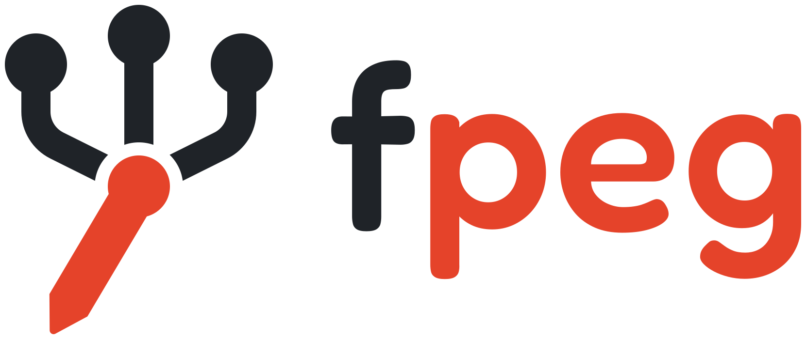

<h1>
  <picture>
    <source media="(prefers-color-scheme: dark)" srcset="docs/_static/logo-dark.svg">
    
  </picture>
</h1>

[](https://github.com/schwimmbeck/fpeg/actions/workflows/ci.yml)
[](#license)
[](pyproject.toml)
[](Cargo.toml)

A general-purpose PEG parsing library with a native engine and a `Transformer` that turns parse trees into your own objects.

> fpeg is at an early stage and not on PyPI yet. Parts of what this page describes are still being built, see the status below.

## The idea

- Write a grammar as plain text and load it at runtime. No code generation and no build step.
- Parse with a native engine written in Rust.
- Get a parse tree with exact source positions, or turn it into your own objects with a `Transformer`, a class with one method per rule.

JSON, from text to Python objects:

```python
import fpeg

grammar = fpeg.Grammar(r"""
    ?start: value
    ?value: object | array | STRING | NUMBER
          | "true" => True | "false" => False | "null" => None
    object: "{" (member ** ",") "}"
    member: key=STRING ":" value=value
    array: "[" (value ** ",") "]"
    STRING: "\"" ([^"\\] | "\\" .)* "\"" => unquote
    NUMBER: "-"? ("0" | [1-9] [0-9]*) ("." [0-9]+)? => float
    %ignore [ \t\r\n]+
""")


class ToPython(fpeg.Transformer):
    def object(self, *members):
        return dict(members)

    def member(self, key, value):
        return key, value

    def array(self, *values):
        return list(values)


tree = grammar.parse('{"name": "fpeg", "tags": ["peg", "rust"], "stable": false}')
print(ToPython().transform(tree))
```

```output
{'name': 'fpeg', 'tags': ['peg', 'rust'], 'stable': False}
```

Each method is named after a rule and gets what its signature asks for: `*members` the children of the node, `key` and `value` its fields. `=> unquote`, `=> float` and the constants are value builders, which make the values of tokens and nodes in the grammar itself, without a Python call.

Operators, with the precedence and the grouping of Python:

```python
import operator

calculator = fpeg.Grammar(r"""
    ?start: expr

    expr: %precedence {
        sum: left=sum op=("+" | "-") right=product -> binary
        product: left=product op=("*" | "/") right=unary -> binary
        unary: "-" operand=unary -> negate
        power: left=atom op="**" right=unary -> binary
        atom: NUMBER | "(" expr ")"
    }

    NUMBER: [0-9]+ ("." [0-9]+)? => float
    %ignore " "+
""")

OPERATORS = {
    "+": operator.add,
    "-": operator.sub,
    "*": operator.mul,
    "/": operator.truediv,
    "**": operator.pow,
}


class Calculate(fpeg.Transformer):
    def binary(self, left, op, right):
        return OPERATORS[op](left, right)

    def negate(self, operand):
        return -operand


print(Calculate().transform(calculator.parse("1 + 2 * 3 - 2 ** 3 ** 2 / -4")))
```

```output
135.0
```

A precedence block lists the operator levels from loosest to tightest. A level that calls itself on the left groups to the left, one that calls itself or a looser level on the right groups to the right, and every operation becomes a node with its operands in fields.

## Install

fpeg is not on PyPI yet. To build it from a checkout, follow [Development](docs/development.md).

## Documentation

The [documentation](docs/index.md) has two tutorials, one that writes a first grammar and one that builds your own objects with a `Transformer`, guides on operator precedence, on building a syntax tree of your own and on performance, and the reference of the grammar language and the Python API.

## What is planned

- **Parsing Expression Grammars**: ordered choice, lookahead and one parse tree for every input, never an ambiguity to resolve.
- **Grammars at runtime**: a grammar is a string or a file. Loading one takes milliseconds.
- **A familiar notation**: rules written much like EBNF, with named fields, operator precedence, grammar modules and indentation-sensitive syntax built in.
- **A native core**: the grammar is compiled to bytecode for a parsing machine. The tree stays in native memory until you ask for a part of it.
- **Transformers and visitors** in Python, called once per node after the parse.
- **Errors that help**: what was expected and where, custom messages in the grammar, and a tree even for broken input.
- **Tooling**: a grammar checker with stable diagnostic codes, a profiler, and later a language server.

The goal for speed is to be the fastest PEG parser that can be used from Python with a grammar loaded at runtime. Benchmarks will be published with the first release, together with the scripts that produce them.

## Status

Early development. The written specification of the grammar language is done, with a reference interpreter that defines what every grammar means, and so are the first versions of the core engine and the Python binding: grammars parse from Python, Rust and the command line, with indentation, captures and back references, operator precedence, left recursion, cuts and grammars that extend and import others, but not yet with error recovery. A `Transformer`, an `Interpreter` or the builders of a grammar turn the tree into objects, and a `Visitor` walks it. `fpeg check` warns about grammars that likely do not do what they seem to, and `fpeg profile` shows where a parse spends its work. An optimizer leaves out work that a grammar seems to ask for, and limits bound the time and the memory of any parse. Next come errors: messages and labels written in the grammar, recovery that still returns a tree, and errors rendered with their source. See the [roadmap](docs/roadmap.md).

## License

Licensed under either of the [MIT licence](LICENSE-MIT) or the [Apache License, Version 2.0](LICENSE-APACHE), at your option.

Unless you explicitly state otherwise, any contribution intentionally submitted for inclusion in fpeg by you, as defined in the Apache-2.0 license, shall be dual licensed as above, without any additional terms or conditions.
