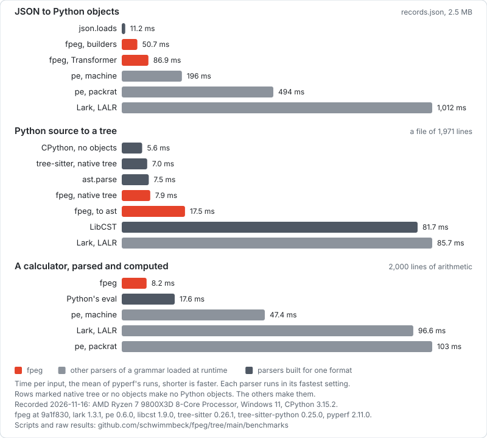

# Benchmarks

Times of fpeg and of other parsers on the same inputs, from the newest run that `benchmarks/run.py --record` wrote for each platform. A time is per call: the mean, its standard deviation and the fastest call. [Contributing](../contributing.md#benchmarks) says how to run the suites, and what each measures.

The chart of the README sums up three of the suites, drawn from the newest record by `benchmarks/chart.py`:



The suite `rust-pgo` is the suite `rust` built with a profile that a short run of fpeg's own workloads trained, as the wheels will be. The other rows are built without one.

```{benchmark-results}
```
